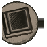
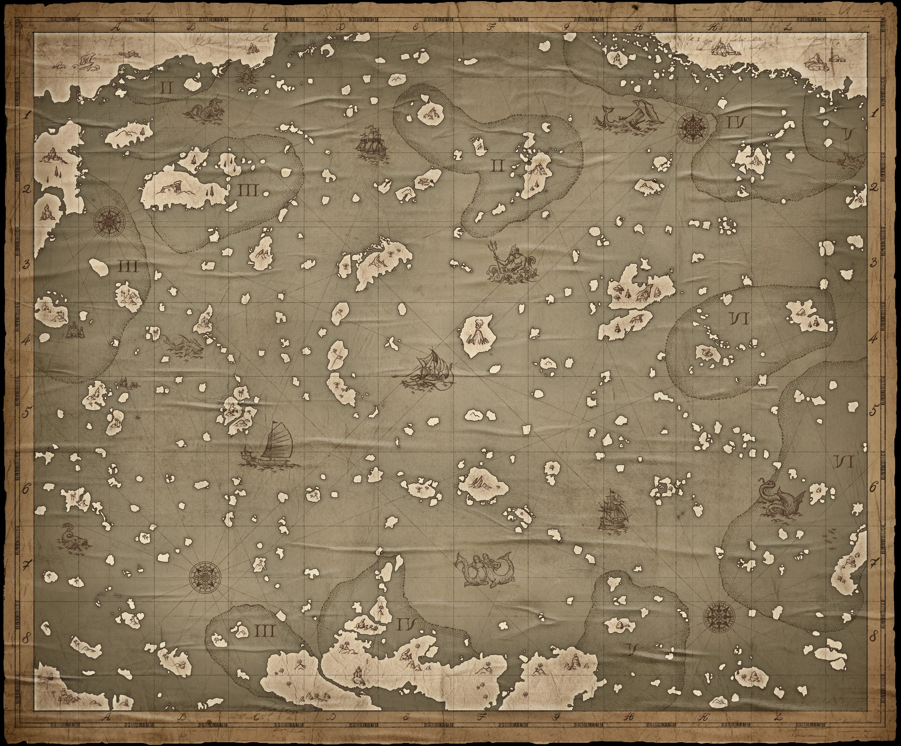
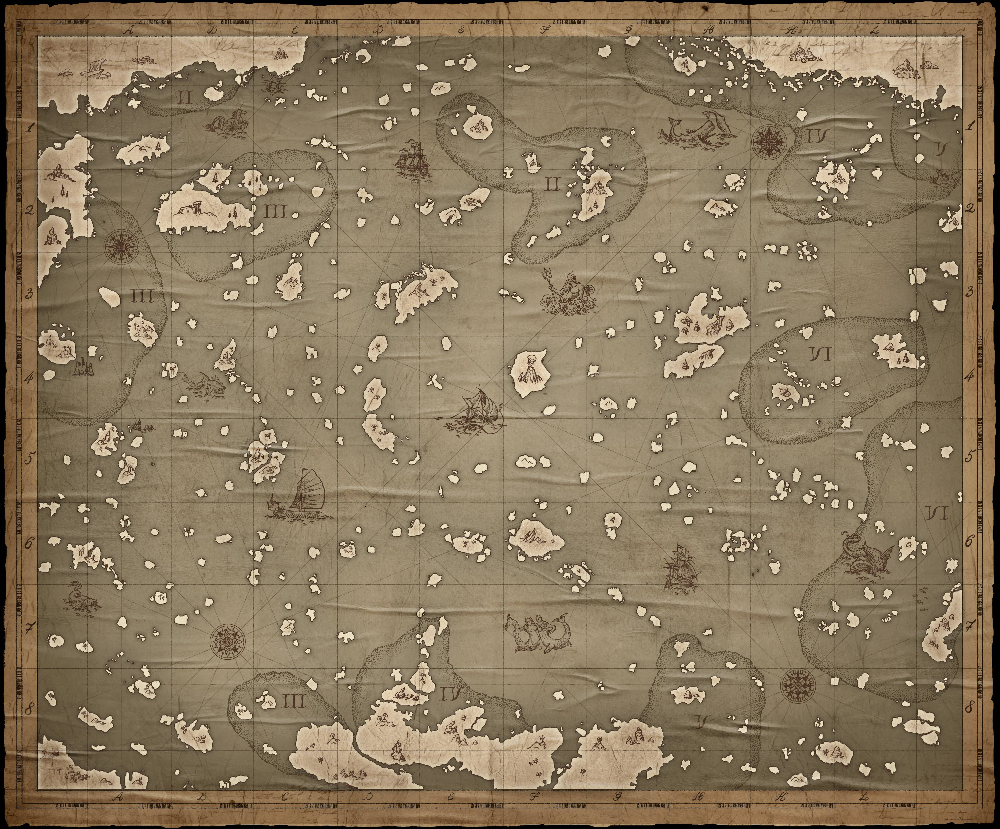

<h2>World chart</h2>

Drag to sail around, ctrl + scroll or pinch to zoom, click a port for its details. The search box above the chart jumps straight to a port.

  

    <button type="button" class="imap-legend-toggle" data-layer="pharos" id="imap-lvl-pharos" aria-pressed="true"> Fast travel</button>
    <button type="button" class="imap-legend-toggle" data-layer="traders" id="imap-lvl-traders" aria-pressed="false"> Traders &amp; settlements</button>
    <button type="button" class="imap-legend-toggle" data-layer="personal" id="imap-lvl-personal" aria-pressed="false"> Mines</button>
    <button type="button" class="imap-legend-toggle" data-layer="regions" id="imap-lvl-regions" aria-pressed="false"> Points of interest: regions</button>
    <button type="button" class="imap-legend-toggle" data-layer="collections" id="imap-lvl-collections" aria-pressed="false"> Points of interest: collections</button>
    <button type="button" class="imap-legend-toggle" data-layer="empire" id="imap-lvl-empire" aria-pressed="false"> Imperial forts</button>
    <button type="button" class="imap-legend-toggle" data-layer="forts" id="imap-lvl-forts" aria-pressed="false"> Port battle &amp; guild forts</button>
    <button type="button" class="imap-legend-toggle" data-layer="routes" id="imap-lvl-routes" aria-pressed="false"> Trade routes</button>
    
       port
       fleet gathering point
       PvP circle, drawn as the game's line of bones
    
  

  

    

      <input id="imap-search" type="text" placeholder="Find a port..." autocomplete="off" spellcheck="false" aria-label="Find a port">
      

    

    

      <button type="button" id="imap-zoom-out" aria-label="Zoom out">&minus;</button>
      <button type="button" id="imap-zoom-reset" aria-label="Reset view">Reset</button>
      <button type="button" id="imap-zoom-in" aria-label="Zoom in">+</button>
    

  

  

    

      
      
      <svg class="imap-routes" id="imap-routes" viewBox="0 0 2400 1987" preserveAspectRatio="none" aria-hidden="true"></svg>
      

      

    

    

    <button type="button" class="imap-fs-btn" id="imap-fs-expand" aria-label="Expand the map to full screen">
      <svg viewBox="0 0 24 24" width="20" height="20" aria-hidden="true" fill="none" stroke="currentColor" stroke-width="2" stroke-linecap="round" stroke-linejoin="round"><path d="M8 3H5a2 2 0 0 0-2 2v3"/><path d="M16 3h3a2 2 0 0 1 2 2v3"/><path d="M8 21H5a2 2 0 0 1-2-2v-3"/><path d="M16 21h3a2 2 0 0 0 2-2v-3"/></svg>
    </button>
    <button type="button" class="imap-fs-btn imap-fs-close" id="imap-fs-close" aria-label="Close full screen" hidden>&times;</button>
    

      <button type="button" class="imap-popup-close" id="imap-popup-close" aria-label="Close">&times;</button>
      

    

  

Full route planning lives in the <a href="{{ '/guides.html' | relative_url }}">trade tool</a>.

<noscript>
  
The interactive chart needs JavaScript. The <a href="/img/map-full.jpg">full-size chart</a> works without it.

</noscript>
